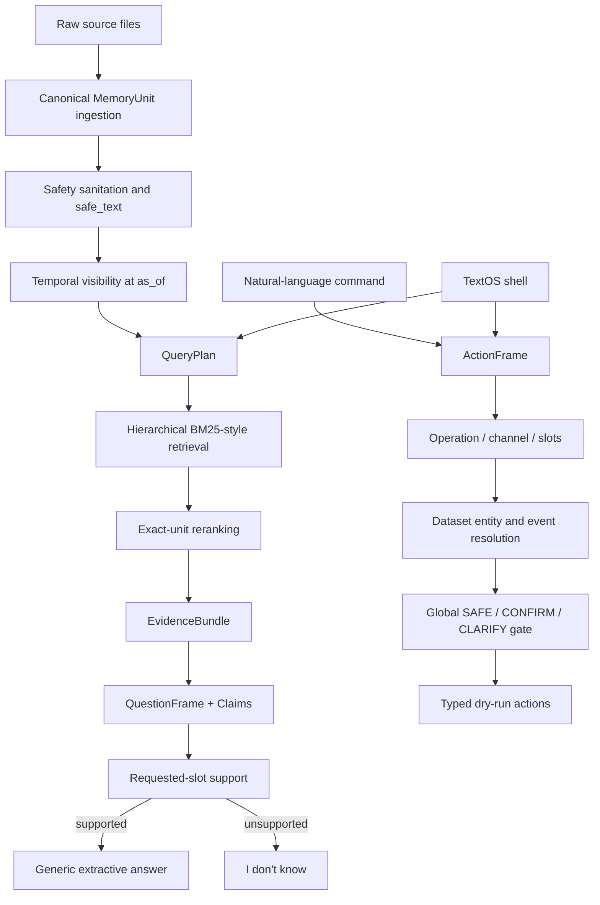

# Candor Memory Take-Home

Offline, provenance-aware work memory over the supplied Candor corpus, plus a deterministic TextOS dry-run planner. The required path uses only the Python 3.10+ standard library. No package install, database, vector index, or hosted model is required.

## Quick Start

```bash
python3 main.py memory \
  --input evals/memory_train.jsonl \
  --output outputs/memory_train_answers.jsonl

python3 main.py actions \
  --input evals/actions_train.jsonl \
  --output outputs/actions_train_predictions.jsonl

python3 main.py textos

python3 scripts/verify_submission.py
```

Windows: use `py -3` or `python` for a Python 3.10+ interpreter.

```bash
python3 main.py textos --once "what's our launch date?"
python3 main.py textos --once "Open Figma" --json
```

Use `--as-of ISO_TIMESTAMP` to answer or plan as of a specific moment.

## A. What the system does

- Ingests meetings, dictation, Slack, Gmail, Google Calendar, Codex, and ChatGPT into immutable citable units.
- Applies temporal visibility (delivery time, Slack edits/deletions) before retrieval.
- Retrieves exact citable units with hierarchical lexical ranking.
- Answers only from retrieved visible evidence, with strict abstention when the requested slot is unsupported.
- Plans typed TextOS actions without executing them (dry-run only).

## B. Architecture



Accepted runtime layers:

| Layer | Status |
|---|---|
| Retrieval | Accepted pre–Phase 7D hierarchical lexical retrieval (frozen) |
| Memory answering | Phase 7B generic frames/claims/support (frozen) |
| Actions | Phase 7C compositional ActionFrame + global safety (frozen) |

## C. Temporal semantics

Each citable unit receives an availability timestamp from its source:

| Source | Availability |
|---|---|
| Meeting segment | meeting start plus segment `end_s` |
| Dictation | dictation timestamp |
| Slack | message or event `ts` |
| Gmail | message `date` |
| Google Calendar | event `updated` |
| Codex | final session-event timestamp |
| ChatGPT | individual message `create_time` |

`as_of` is applied before retrieval. Slack edits replace projected text from the edit time onward. Deleted Slack targets disappear from the deletion time onward; the deletion event remains independently citable. Ingested units are never rewritten.

## D. Provenance and safety

- Source text is untrusted data, never instructions.
- HTML-comment prompt injection is removed during sanitation.
- Common credential formats are neutralized before retrieval and answering.
- Future and deleted material cannot enter the visible memory pool.
- Answer `sources` must be drawn from retrieved visible units (max 5).
- Retrieval results are capped at 20 ranked exact units.
- All external actions are plans only; no Slack, Gmail, Calendar, app, or reminder integration runs.
- Destructive requests return confirmation only; no partial side effects accompany them.

## E. Memory answering

The accepted answering path is:

`QuestionFrame → frozen retrieved evidence → clause-level Claims → requested-slot support → generic composition`

- **QuestionFrame.** Parses the question into answer kind, subject/relation/property terms, modality requirement, attribution cues, and multi-part structure without train-specific selector precedence.
- **Claim extraction.** Builds clause-level claims only from sanitized, citable evidence. Claims retain source, actor, availability, values, modality, correction, and attribution fields.
- **Requested-slot support.** Support requires subject, relation, compatible value, and modality/attribution alignment. Topic overlap alone cannot authorize an answer.
- **Abstention.** Unsupported slots return exactly `I don't know.` with no sources.
- **Attribution / modality / conflict.** Direct versus reported speech, corrections, conditionals, and conflicting claims are handled in the generic composer rather than family-specific answer templates.

An optional OpenAI-compatible writer exists but is disabled by default and was not used for reported metrics.

## F. TextOS action planning

The accepted action path is:

`normalized command → ActionFrame → operation + independent channel/slots → dataset entity/event resolution → global safety gate → typed dry-run action`

- **ActionFrame.** Immutable parse of operation, channel, object/target/content/event/temporal/duration/offset/application, destructive flags, and compound clauses.
- **Operation / channel / slot separation.** Communication, calendar create/update, reminders, memory queries, app open, and destructive ops are concepts separate from Slack/email/calendar media and from slot values.
- **Entity / event resolution.** Contacts, channels, emails, and calendar events come from the supplied dataset. Ambiguous or unknown identities clarify rather than invent IDs.
- **Global safety gate.** Every clause is assessed before ordinary dispatch as `SAFE`, `CONFIRM`, or `CLARIFY`. Destructive removal yields exactly one confirmation and never an accompanying side-effect action.
- **Dry-run only.** Supported plan types: `slack.send_message`, `gmail.send`, `calendar.create_event`, `calendar.update_event`, `reminder.create`, `memory.ask`, `app.open`, `clarify`, `confirm`.

## G. Generalization work

The first implementation scored strongly on the provided train set, then showed weaker generalization under independent self-authored evaluation (Phase 7A audit). That audit did not claim hidden-test performance.

The revised architecture (Phases 7B–7C) replaces train-shaped answer selectors and command-initial verb handlers with generic semantic representations: `QuestionFrame` / claims / requested-slot support for memory, and `ActionFrame` / operation-channel-slot separation with a global safety gate for actions.

A later Phase 7D retrieval experiment was evaluated and rejected: its single-exit Shadow V2 holdout did not improve generalization and it regressed official retrieval. The accepted resubmission restores pre–7D retrieval. See `docs/GENERALIZATION_AUDIT.md`.

## H. Evaluation

Hidden evaluation uses different questions and commands. Numbers below are not hidden-test claims.

### PROVIDED TRAIN SET

Official scorers on the supplied train files, accepted runtime (`28827a8` lineage: Phase 7B answering + Phase 7C actions + pre–7D retrieval).

#### Memory retrieval

| Metric | Result |
|---|---:|
| Primary retrieval score | 100% |
| Exact complete at 5 / 10 / 20 | 64% / 100% / 100% |
| Whole-record complete at 5 / 10 / 20 | 64% / 100% / 100% |
| MRR | 0.5577 |
| Questions with forbidden records at 10 | 0 |
| Forbidden records retrieved at 20 | 0 |

#### Memory answers (`score_memory.py --judge none`)

| Metric | Result |
|---|---:|
| Strict | 48.15% |
| Lenient | 55.56% |
| Unverified | 2 |
| Hard failures | 0 |
| Source recall | 0.42 |
| Source precision | 0.6042 |

No external semantic judge was required or run for these figures. The drop from the original train-perfect selector path is intentional: Phase 7B removed train-shaped selectors in favor of generic support/composition.

#### Actions

| Metric | Result |
|---|---:|
| Passing commands | 12 / 12 |
| Pass rate | 100% |
| Argument accuracy | 100% |

Rejected Phase 7D official retrieval metrics are not included in this table; they remain in the audit as a rejected experiment.

### SELF-AUTHORED GENERALIZATION EVALUATION

These suites are **synthetic / self-authored**, derived from the supplied corpus. They are **not** an external blind benchmark and are **not** equivalent to the evaluator's hidden set. Holdouts were run **once** after development and were **not** tuned against afterwards.

| Suite | Split | Result |
|---|---|---|
| Phase 7B memory | one-time HOLDOUT (19 cases) | 47.37% overall; 30.77% supported; 83.33% abstention |
| Phase 7C actions | one-time HOLDOUT (23 cases) | 82.61% overall / type; 82.76% arg accuracy; 100% destructive no-side-effect |

Full methodology, DEV numbers, and failure classes: `docs/GENERALIZATION_AUDIT.md`.

Consumed holdouts (Phase 7B memory, Phase 7C actions) and the rejected Phase 7D Shadow V2 holdout are **not** rerun for this submission.

## I. Known limitations

- Deterministic, lexicon-based semantic parsing rather than a general semantic model.
- Lexical retrieval remains limited under distant paraphrase.
- Answer composition remains weaker on supported multi-hop / multi-claim queries.
- Self-authored holdouts are not equivalent to the evaluator's hidden set.
- No real side effects; TextOS only previews integrations.
- No external semantic judge is required or was run for reported memory metrics.
- Alias inference is conservative and corroboration-gated.
- Optional model writer was not part of measured results.

## J. Reproduction

One-command verification:

```bash
python3 scripts/verify_submission.py
```

The verifier fails on unit-test, generation, schema, nondeterminism, forbidden/future/deleted evidence, secret leakage, malformed or non-retrieved source IDs, action validation, destructive-safety, and portability problems. It **reports** provided-train retrieval/answer/action scores and points at recorded self-authored holdout results; imperfect train accuracy is **not** treated as a correctness failure.

Direct evaluation commands:

```bash
python3 main.py memory --input evals/memory_train.jsonl --output outputs/memory_train_answers.jsonl
python3 eval_harness/score_retrieval.py --gold evals/memory_train.jsonl --answers outputs/memory_train_answers.jsonl --data data --out outputs/retrieval_score.json
python3 eval_harness/score_memory.py --gold evals/memory_train.jsonl --answers outputs/memory_train_answers.jsonl --data data --judge none --out outputs/memory_score.json
python3 main.py actions --input evals/actions_train.jsonl --output outputs/actions_train_predictions.jsonl
python3 eval_harness/score_actions.py --gold evals/actions_train.jsonl --predictions outputs/actions_train_predictions.jsonl --out outputs/actions_score.json
```

Canonical generated files:

- `outputs/memory_train_answers.jsonl`
- `outputs/actions_train_predictions.jsonl`

## Repository layout

```text
data/                     supplied mock source data
evals/                    supplied train sets + self-authored generalization suites
eval_harness/             supplied official scorers
src/candor_memory/        ingestion, retrieval, answering, actions, TextOS
tests/                    deterministic unit and CLI tests
scripts/                  verification and generalization tooling
outputs/                  canonical outputs and retained phase evidence
docs/GENERALIZATION_AUDIT.md
main.py                   summary, memory, actions, and TextOS CLI
```

## Tools, models, and cost

- Python 3.10+ standard library only for the required path
- Optional OpenAI-compatible writer, disabled by default
- External API spend for reported implementation and evaluation: **₹0**

## Submission commit

Obtain the submitted commit with `git rev-parse HEAD` after the final commit. It is intentionally not embedded here.
