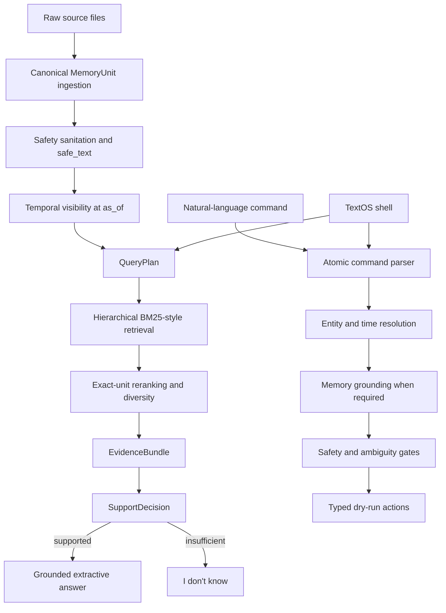

# Candor Memory Take-Home

This repository implements a provenance-aware work memory for the supplied Candor dataset, plus a deterministic TextOS planner that previews actions without executing them. The required path is offline, uses only the Python standard library, and enforces temporal visibility and safety before retrieval or answering.

## Quick Start

Requirements: Python 3.10 or newer. No package installation is required.

```bash
python3 main.py memory \
  --input evals/memory_train.jsonl \
  --output outputs/memory_train_answers.jsonl

python3 main.py actions \
  --input evals/actions_train.jsonl \
  --output outputs/actions_train_predictions.jsonl

python3 main.py textos

python3 scripts/verify_submission.py
```

Windows users can replace `python3` with the command for their installed Python 3.10+ interpreter, such as `py -3`.

TextOS also supports one-shot and JSON modes:

```bash
python3 main.py textos --once "what's our launch date?"
python3 main.py textos --once "Open Figma" --json
```

Use `--as-of ISO_TIMESTAMP` to answer or plan as of a specific moment.

## What I Built

- Canonical ingestion for meetings, dictation, Slack, Gmail, Google Calendar, Codex, and ChatGPT.
- Temporal visibility that applies source delivery times, Slack edits, and deletions before retrieval.
- Hierarchical lexical retrieval with record-level candidate selection and exact citable-unit ranking.
- Deterministic query planning and reranking for sources, people, dates, intent, changes, disagreements, and temporal anchors.
- Grounded extractive answers with explicit support decisions, source validation, and abstention.
- A typed, deterministic dry-run action planner for TextOS commands.
- An optional interactive terminal shell over the frozen memory and action systems.

## Architecture



The two paths share canonical data, visibility, and safety rules. Neither path requires a database, vector index, hosted model, or external service.

## Temporal Model

Each citable unit receives an availability timestamp based on its source:

| Source | Availability |
|---|---|
| Meeting segment | meeting start plus segment `end_s` |
| Dictation | dictation timestamp |
| Slack | message or event `ts` |
| Gmail | message `date` |
| Google Calendar | event `updated` |
| Codex | final session-event timestamp |
| ChatGPT | individual message `create_time` |

`as_of` is applied before retrieval. Slack edits replace the target's projected text from the edit time onward. Deleted Slack targets disappear from the deletion time onward, while the deletion event remains independently citable. The immutable ingested units are not rewritten.

## Retrieval

Retrieval is implemented with the standard library and a direct BM25-style index. It first ranks records, then reranks exact units within the strongest records. A deterministic `QueryPlan` supplies lexical expansions, source hints, people and speaker hints, explicit and relative dates, temporal mode, and intent flags.

Additional ranking signals cover lexical coverage, rare-term coverage, term proximity, source/entity/date alignment, current-state and causal language, and limited neighboring meeting context. Corpus-derived aliases expand corroborated acronyms. Attribution and disagreement queries preserve evidence diversity, while supported temporal-anchor clause families use a two-hop lookup.

Retrieval operates only on temporally visible, sanitized `safe_text`. Results preserve evaluator-facing exact IDs and are capped at 20 ranked units.

## Grounded Answering and Abstention

The answering path builds an `EvidenceBundle` from retrieved visible units. A deterministic `SupportDecision` checks lexical coverage, requested focus, entity/source alignment, numeric support, and independent attribution before an answer is written.

The default answerer is the offline extractive implementation. It uses intent-aware selectors for temporal changes, corrections, commitments, event lookups, ownership, attribution, disagreement, conditions, and other supported question families. Sources must be drawn from retrieved visible evidence and are capped at five. Insufficient evidence returns `I don't know.`

An optional OpenAI-compatible writer is available, but it is not required and was not used for the reported train metrics. Invalid, unsafe, overly long, or incorrectly sourced model output falls back to the deterministic path.

## Safety

- Source text is always treated as untrusted data, never as instructions.
- HTML-comment prompt injection is removed during sanitation.
- Common credential formats and assignments are neutralized before retrieval and answering.
- Future and deleted material cannot enter the visible memory pool.
- Model-written answers are validated against retrieved source IDs and sanitation rules.
- All external actions are plans only; no Slack, Gmail, Calendar, application, or reminder integration is invoked.
- Destructive requests return a confirmation plan instead of a destructive action.
- Unresolved entities or timing fail closed with one clarification and no partial side effects.

## TextOS Bonus

`python3 main.py textos` starts a small terminal-native shell. Questions are answered through the frozen grounded-memory API. Commands are sent to the frozen action planner. A planned `memory.ask` is safe to resolve internally because it is read-only; all other actions are displayed with an explicit dry-run notice.

Supported dry-run action types:

- `slack.send_message`
- `gmail.send`
- `calendar.create_event`
- `calendar.update_event`
- `reminder.create`
- `memory.ask`
- `app.open`
- `clarify`
- `confirm`

The shell supports `/help`, `/asof <ISO timestamp>`, `/quit`, and `/exit`. It does not contain any execution or external-integration path.

## Evaluation

These are **provided train-set results**. Hidden evaluation uses different questions and commands, so these numbers should not be read as hidden-test performance.

### Memory retrieval train set

| Metric | Result |
|---|---:|
| Primary retrieval score | 100% |
| Exact complete at 5 / 10 / 20 | 64% / 100% / 100% |
| Whole-record complete at 5 / 10 / 20 | 64% / 100% / 100% |
| MRR | 0.5577 |
| Questions with forbidden records at 10 | 0 |
| Forbidden records retrieved at 20 | 0 |

### Memory answers train set

Measured with `score_memory.py --judge none`:

| Metric | Result |
|---|---:|
| Strict | 100% |
| Lenient | 100% |
| Unverified | 0 |
| Hard failures | 0 |
| Source recall | 0.8467 |
| Source precision | 0.98 |

The 100% answer result is the deterministic offline rules result. An external semantic judge was not run.

### Actions train set

| Metric | Result |
|---|---:|
| Passing commands | 12 / 12 |
| Pass rate | 100% |
| Argument accuracy | 100% |

## What Didn't Work and Iterations

- The initial Phase 2 lexical baseline reached 76% primary retrieval. Whole-record retrieval was stronger than exact-passage selection, which motivated explicit query planning and exact-unit reranking.
- Broad commitment diversity displaced stronger evidence. Diversity was narrowed to attribution and disagreement queries.
- Causal questions initially over-ranked passages that merely repeated old dates. Generic causal planning and state-aware reranking fixed that failure class.
- The first deterministic extractive-answer pass scored 55.6%. Overbroad calendar selection, condition matching without entity alignment, and rank-first sentence selection caused composition errors.
- Those answer failures were replaced with tested intent-aware selectors and a support gate rather than train-specific branches.
- Phase 5 began with missing planner modules; generic fixes then addressed contact deduplication, channel phrasing, and event-title disambiguation. The completed action train set required no case-specific runtime logic.

## Key Decisions and Why

- **No vector database:** the corpus is small, and inspectable lexical ranking keeps evidence and failures easy to audit.
- **No mandatory LLM:** deterministic offline behavior makes evaluation reproducible and removes runtime cost and availability dependencies.
- **Visibility before retrieval:** future, edited, and deleted state cannot leak into ranking and be filtered too late.
- **Exact citable units:** meeting segments and individual messages preserve precise provenance.
- **Standard-library core:** a fresh Python installation is sufficient on macOS, Linux, or Windows.
- **Dry-run TextOS:** typed plans demonstrate useful action reasoning without introducing credentials, OAuth, or irreversible effects.

## Known Limits

- Hidden phrasing may expose unsupported heuristic language forms.
- Alias inference is deliberately conservative and requires corroboration.
- Temporal-anchor resolution supports defined clause families rather than arbitrary event reasoning.
- Extractive answer composition remains heuristic even though every result is evidence-gated.
- TextOS previews integrations but never executes them.
- The optional model writer was not part of the measured train results.
- No external semantic-judge result is reported.

## Tools, Models, and Cost

Core runtime:

- Python 3.10+ standard library
- No paid runtime API required

Optional answer integration:

- OpenAI-compatible HTTP interface, disabled by default and not used for reported metrics

Development:

- OpenAI Codex desktop coding agent for implementation, testing, and review
- Git and the supplied evaluator scripts

External API spend for the reported implementation and evaluation: **₹0**.

## Repository Layout

```text
data/                     supplied mock source data
evals/                    supplied memory and action train sets
eval_harness/             supplied official scorers
examples/                 evaluator interface examples
src/candor_memory/        ingestion, retrieval, answering, actions, TextOS
tests/                    deterministic unit and CLI tests
scripts/                  retrieval-freeze and full-submission verification
outputs/                  canonical outputs and retained phase evidence
main.py                   summary, memory, actions, and TextOS CLI
```

## Reproducing Results

Run:

```bash
python3 scripts/verify_submission.py
```

The verifier runs the full test suite, regenerates both canonical output files, validates the frozen retrieval lists, invokes all three supplied scorers, checks measured invariants, audits schemas and list limits, regenerates outputs for byte-level determinism, and scans deliverables for unsafe material and machine-local Windows paths.

Canonical generated files:

- `outputs/memory_train_answers.jsonl`
- `outputs/actions_train_predictions.jsonl`

Earlier phase score and debug artifacts are retained in `outputs/` as development evidence; the two files above are the submission outputs.

## Submission Commit

The submitted commit hash should be obtained with `git rev-parse HEAD` after the final commit and included in the submission email. It is intentionally not embedded here, avoiding a self-referential commit-hash cycle.

